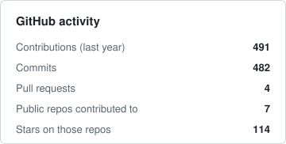
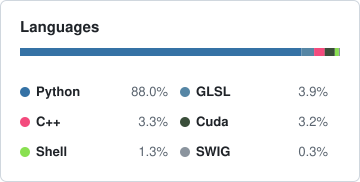

### Hi, I'm Hongwei 👋

M.S. student in Computer Science at **UC San Diego**, working in the [Autonomous Vehicle Laboratory](https://hichristensen.com/) with Prof. Henrik I. Christensen and collaborating with [VAIL @ UCLA](https://vail-ucla.github.io/) (Prof. Bolei Zhou).

I work on **end-to-end autonomous driving**, with a focus on closed-loop driving policies: how they behave once their own actions shape what they see next. I use photorealistic neural simulation built from real-world driving logs to study and improve them.

🌐 [Homepage](https://hongweiruan.github.io/) · 🎓 [Google Scholar](https://scholar.google.com/citations?user=zoVOZB0AAAAJ) · ✉️ horuan@ucsd.edu

---

#### 📄 Research

- **[NavSafe-∞](https://github.com/VAIL-UCLA/NavSafe-infty)** — Benchmarking closed-loop driving safety in photorealistic environments  
  arXiv 2026 · co-first author · [paper](https://arxiv.org/abs/2609.26618) · [project](https://navsafe-vail.github.io/) · [dataset](https://huggingface.co/datasets/c13752hz/NavSafe)
- **[BridgeSim](https://github.com/VAIL-UCLA/BridgeSim)** — Unveiling the open-loop / closed-loop gap in end-to-end driving  
  CoRL 2026 · [paper](https://arxiv.org/abs/2604.10856) · [project](https://vail-ucla.github.io/BridgeSim/)

---

  
  

<picture>
  <source media="(prefers-color-scheme: dark)" srcset="assets/snake-dark.svg" />
  
</picture>
